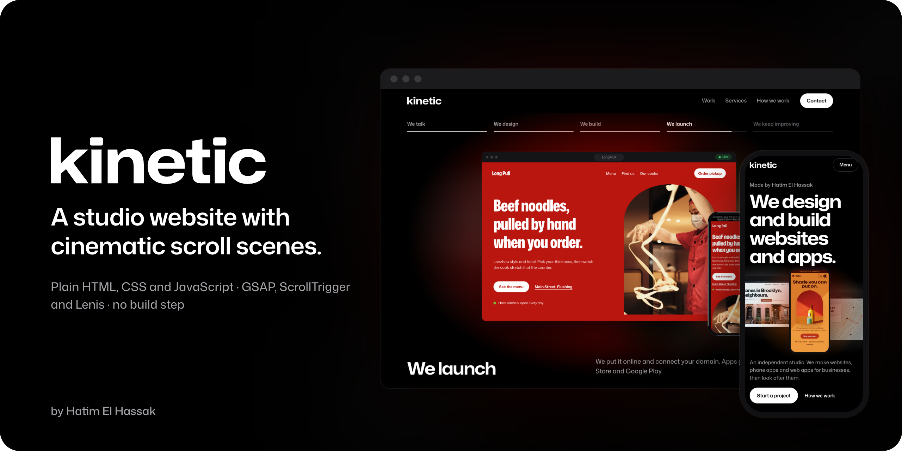
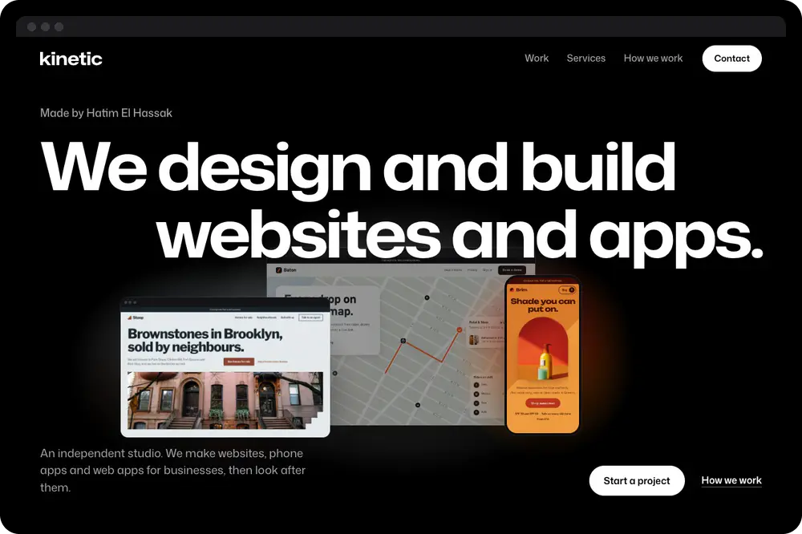
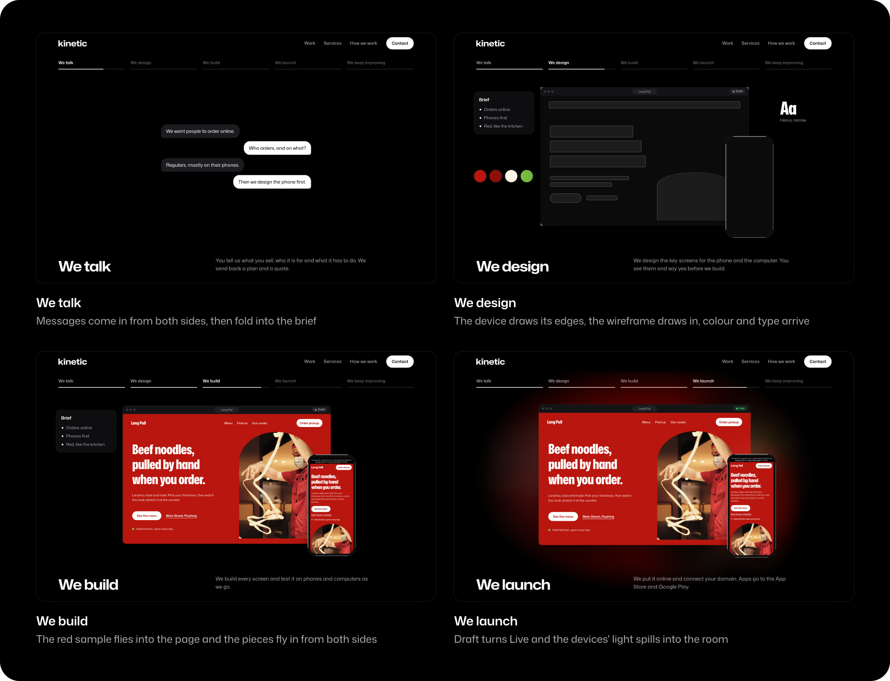
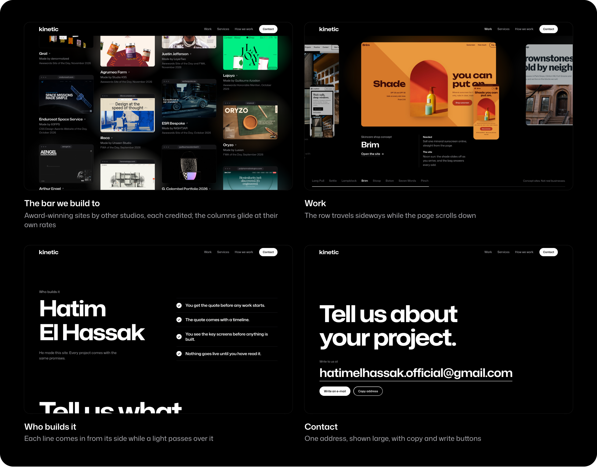
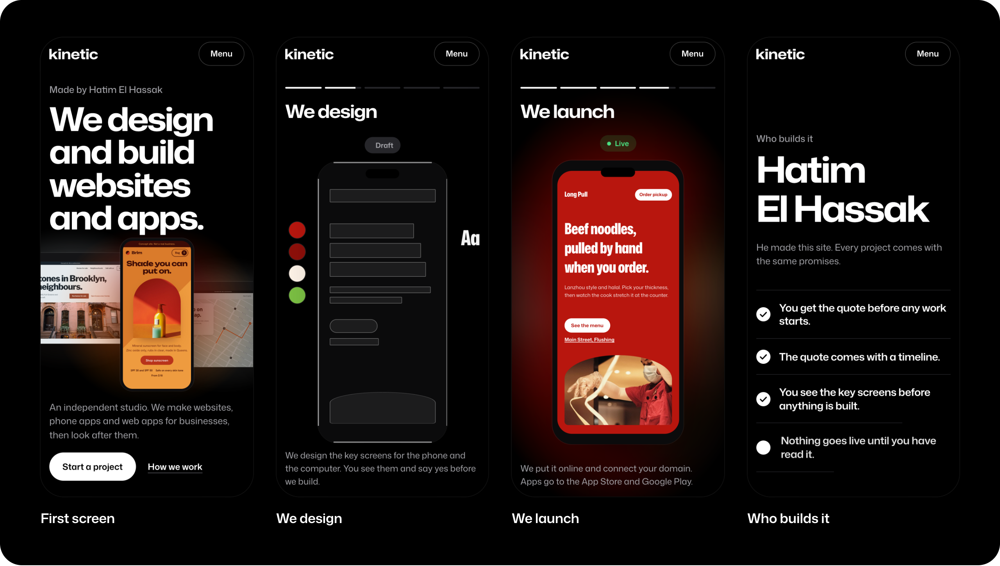
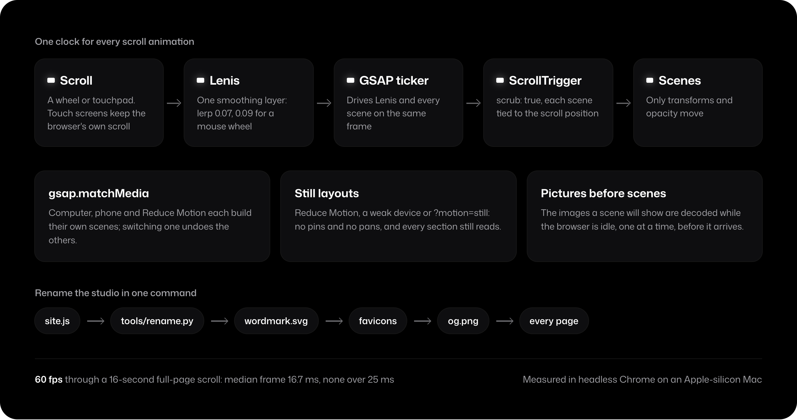

<p align="center">
  
</p>

<p align="center">
  <b>A website template for design and development studios.</b><br>
  Scroll scenes that tell the studio's story, smooth scrolling, and no build step.
</p>

<p align="center">
  <a href="https://hatimhtm.github.io/kinetic/"><b>Live&nbsp;demo</b></a>&nbsp;&nbsp;·&nbsp;&nbsp;<a href="#quick-start">Quick&nbsp;start</a>&nbsp;&nbsp;·&nbsp;&nbsp;<a href="#use-it-with-your-ai">Use&nbsp;it&nbsp;with&nbsp;your&nbsp;AI</a>&nbsp;&nbsp;·&nbsp;&nbsp;<a href="#how-it-works">How&nbsp;it&nbsp;works</a>&nbsp;&nbsp;·&nbsp;&nbsp;<a href="#license">License</a>
</p>

<p align="center">
  
</p>

## About

Kinetic is the website of a small studio that designs and builds websites, apps and web apps. It is meant to be the studio's proof of craft: the pages move a lot, but every scene explains something (how the studio works, what it makes, who builds it), and every claim on the page is one the studio can keep.

It is a complete site, not a landing page: home, work, services and contact pages, eight concept sites that show the range of work, and a wall of award-winning sites made by other studios, each one credited and linked, for clients to point at when they describe what they want.

## Highlights

- **A story told by scrolling.** "How we work" holds one stage while five steps play on it: talk, design, build, launch, keep improving.
- **Smooth, never floaty.** One smoothing layer (Lenis) and one clock (GSAP's ticker). Every scene is tied straight to the scroll position.
- **Phones get their own scenes.** Each scene has a phone version designed for a 390 px screen, not a shrunken desktop.
- **Motion that steps aside.** Reduce Motion, a low-power device or `?motion=still` turns every scene into a still layout that reads top to bottom.
- **Proof in the visitor's browser.** The last section reads the page's own load time from the browser and shows it, rounded to a tenth of a second.
- **Yours in one command.** `tools/rename.py` renames the studio everywhere and redraws the wordmark, the favicons and the link preview.
- **No build step.** Plain HTML, CSS and JavaScript. Any static server runs it.

## Screenshots

<p align="center">
  
</p>
<p align="center">
  
</p>
<p align="center">
  
</p>

## How it works

<p align="center">
  
</p>

### One clock

`main.js` builds the home page's scenes and `pages.js` builds the other pages'. Lenis smooths wheel and touchpad scrolling (lerp `0.07`, `0.09` for a notched mouse wheel) and is driven by GSAP's ticker, so the smoothing and every animation advance on the same frame (`gsap.ticker.lagSmoothing(0)`). Touch screens keep the browser's own scroll, which already feels right under a finger.

Every scroll animation uses `scrub: true`: its progress is the scroll position, never a timer. Positions move linearly or along a curve inside their own short window, and only `transform` and `opacity` change, so the browser never has to lay the page out again during a scroll.

### Scenes per layout

`gsap.matchMedia()` builds one set of scenes for computers, one for phones and one for Reduce Motion. When the window crosses the breakpoint or the setting changes, GSAP reverts the old set before it builds the new one. A matchMedia callback only runs while one of its conditions matches, so phones have a condition of their own instead of being "not a computer".

### The held stage

The "How we work" act is pinned for its whole height. Its progress, from 0 to 1, is cut into five windows, one per step. Each step plays inside its window and lands at a fixed point, so the rail at the top always says where you are and a step never stops half-played.

### Pictures before scenes

The screens and photos a scene will show are fetched and decoded with `img.decode()` while the browser is idle (`requestIdleCallback`), one at a time, before the scene arrives. A scene never waits for an image in the middle of a scroll.

### Still layouts

With Reduce Motion, on a low-power device (fewer than 4 cores, under 4 GB of memory, or Data Saver on), or with `?motion=still` in the address, no scene is built: no pins, no sideways pans, no smoothing. The sections stack and every word stays readable. `?motion=full` forces the scenes back on for testing.

### Performance

Measured in headless Chrome on an Apple-silicon Mac, scrolling the home page from top to bottom in 16 seconds: 983 frames, median 16.7 ms, 99th percentile 16.8 ms, none over 25 ms.

## Quick start

Click **Use this template** at the top of this page, or clone it:

```bash
git clone https://github.com/hatimhtm/kinetic.git
cd kinetic
python3 -m http.server 8080
```

Then open <http://localhost:8080>. There is nothing to install.

## Make it yours

| What | Where |
|---|---|
| Studio name, wordmark, favicons, link preview | `python3 tools/rename.py "Your Studio"` |
| Contact e-mail | `site.js` (`STUDIO.email`), and 3 times in `contact/index.html` |
| Your name on the first screen and in "Who builds it" | `index.html` |
| The promises in "Who builds it" | `index.html`. Keep only the ones you keep |
| The award-winning sites on the wall | `site.js` (`window.MENU`) |
| Your own projects in place of the concept sites | `site.js` (concept slots) and `concepts/` |
| The words on the link-preview picture | `python3 tools/og-base.py "Made by Your Name"`, then `rename.py --from` |

The two tools need Python 3 with `fonttools`, `brotli` and `pillow` (`pip3 install fonttools brotli pillow`).

## Use it with your AI

Kinetic ships with notes for coding agents: [`AGENTS.md`](AGENTS.md), with an identical copy as `GEMINI.md`, so that Codex, Cursor, Gemini and other coding agents find them. They describe the files, what to fill in before going live, the rules that keep the site fast and honest, and how to publish it.

Open the folder in your agent and ask, for example:

```text
Make this my studio's website. The studio is called Northlight, my name is Sara Okafor and
my e-mail is hello@northlight.studio. Put my three projects in place of the concept sites.
```

## Deploy

It is a static site with no build step.

- **Vercel:** import the repository, choose the Framework Preset "Other" and leave the build command empty. `.vercelignore` keeps the notes, the README and `tools/` off the live site.
- **GitHub Pages, Netlify, Cloudflare Pages:** publish the repository's root folder.

## Project structure

```
kinetic/
├── index.html           the home page and its scenes
├── work/                concept sites, travelling sideways
├── services/            what the studio makes and its commitments
├── contact/             one address, shown large
├── concepts/            eight concept sites (made-up brands, each labelled)
├── site.js              the studio's name and e-mail, the award wall, the concept slots
├── main.js              the home page's motion
├── pages.js             the other pages' motion
├── nav.js               the bar and the phone menu
├── styles.css           the home page and the shared parts
├── pages.css            the other pages
├── assets/              pictures, fonts, icons, the wordmark
├── vendor/              GSAP, ScrollTrigger and Lenis
└── tools/               rename.py, og-base.py and the wordmark drawing (not deployed)
```

## Built with

- **Motion:** [GSAP](https://gsap.com) 3.15 and ScrollTrigger, [Lenis](https://lenis.darkroom.engineering) 1.3
- **Type:** [Mona Sans](https://github.com/github/mona-sans), variable, subset to Latin
- **Pages:** HTML, CSS and JavaScript, with no framework and no bundler
- **Tools:** Python, fontTools and Pillow

## License

Kinetic is free for personal and other non-commercial use under the [PolyForm Noncommercial License 1.0.0](LICENSE). Keep its `Required Notice` line with every copy. The demo's own pictures and words are under [CC BY-NC 4.0](https://creativecommons.org/licenses/by-nc/4.0/).

**Using it for a business?** A commercial license is available. Write to [hatimelhassak.official@gmail.com](mailto:hatimelhassak.official@gmail.com).

Third-party parts keep their own licenses: see [NOTICE.md](NOTICE.md).

## Credits

- The screenshots on the award wall belong to the studios named on each card, and each card links to the real site.
- The photos in the concept sites are credited on each concept page.
- GSAP by GreenSock, Lenis by darkroom.engineering, Mona Sans by GitHub.

<br>

<p align="center">
  Made by <a href="https://hatimelhassak.is-a.dev"><b>Hatim El Hassak</b></a>. I design and build apps and websites.<br>
  <a href="https://hatimelhassak.is-a.dev">Portfolio</a>&nbsp;&nbsp;·&nbsp;&nbsp;<a href="https://cal.com/hatimelhassak/engineering-discovery">Book a call</a>&nbsp;&nbsp;·&nbsp;&nbsp;<a href="mailto:hatimelhassak.official@gmail.com">E-mail</a>
</p>
